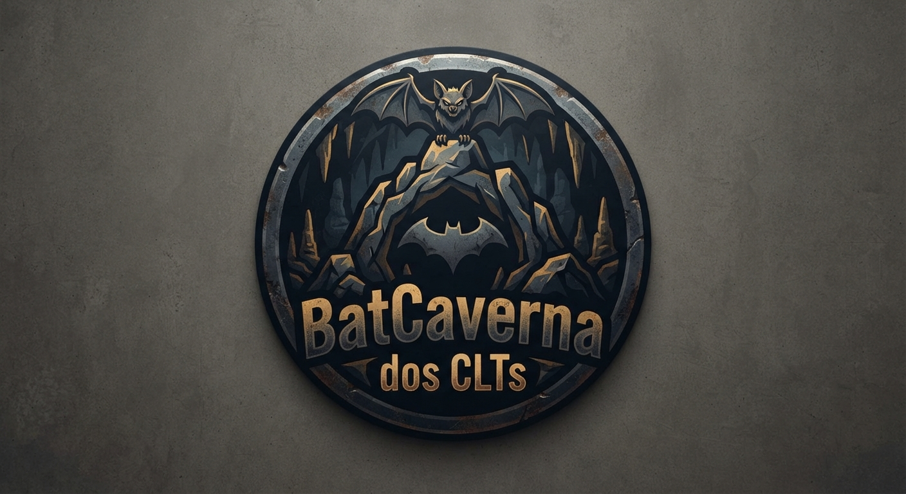
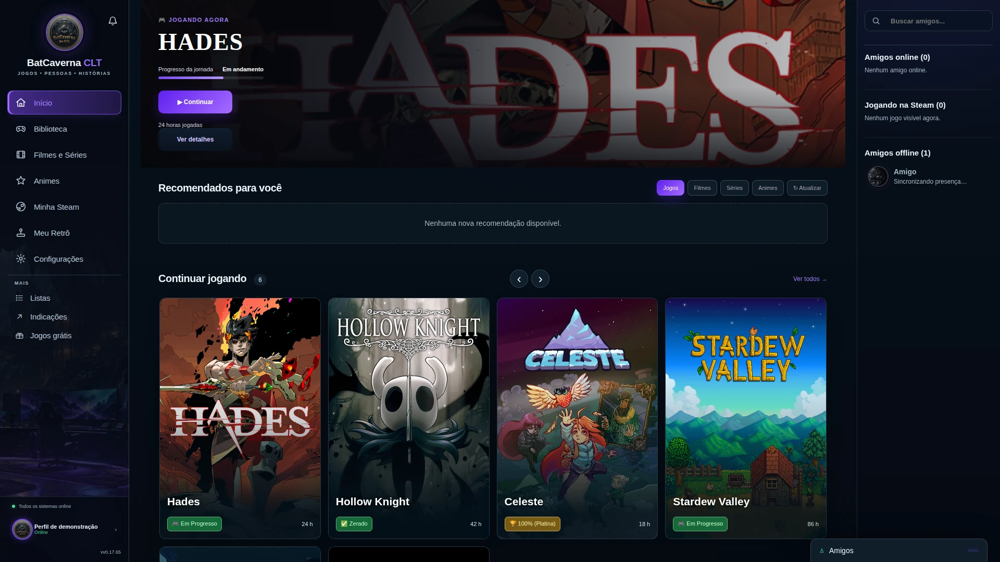
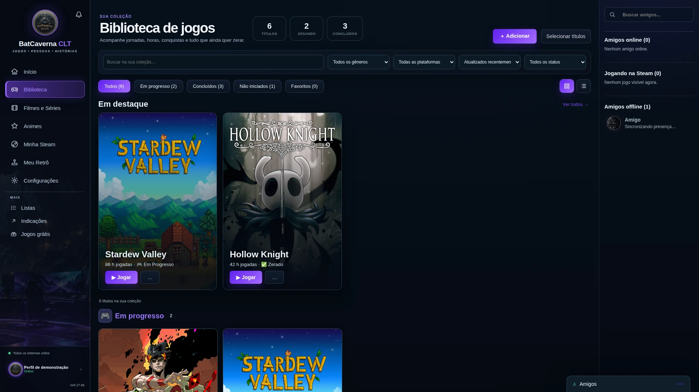
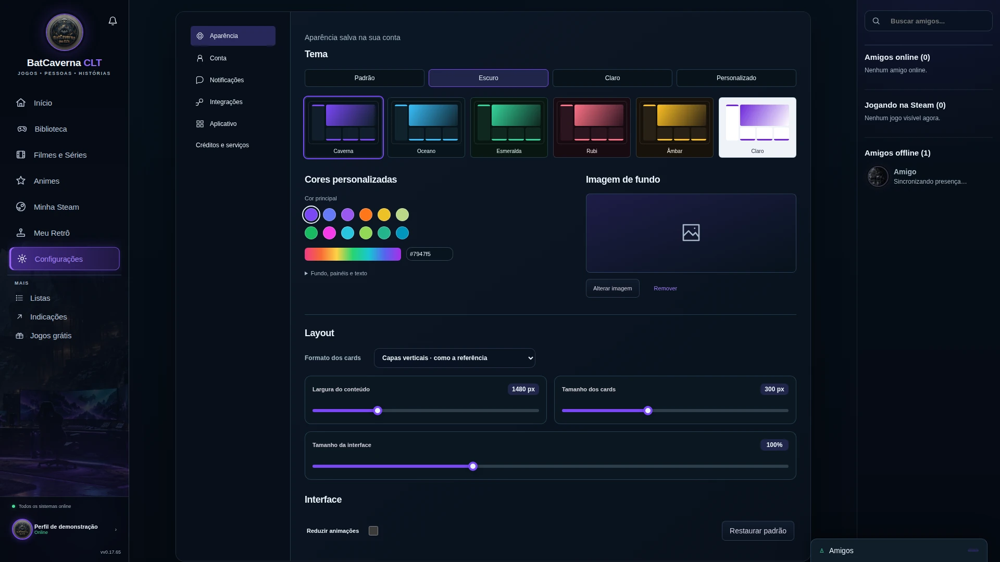

  

<h1 align="center">BatCaverna CLT</h1>

  Seus jogos, filmes, séries e animes, organizados no mesmo lugar. 
  Acompanhe sua coleção no Windows e no Android.

  <a href="#baixar">Baixar o aplicativo</a> ·
  <a href="#recursos">Conhecer os recursos</a> ·
  <a href="#por-dentro-do-batcaverna">Ver as telas</a> ·
  <a href="https://batcavernaclt.gamersclt.workers.dev/">Visitar o site</a>

Interface atual com dados de demonstração.

**Um organizador pessoal para quem joga e acompanha histórias.** Guarde o que pretende começar, registre o que já concluiu, avalie seus títulos e troque indicações com amigos. A mesma conta mantém sua coleção sincronizada entre o computador e o celular.

## Baixar

O BatCaverna é gratuito. Os downloads abaixo levam aos arquivos oficiais usados no site do projeto.

| Plataforma | Disponibilidade | Download |
| --- | --- | --- |
| **Windows** | Aplicativo desktop com instalador `.exe` | [Baixar para Windows](https://drive.usercontent.google.com/download?id=1tWVxsv3OJj_6HYZNcPPjcKT0MjEb_uT-&export=download) |
| **Android** | Aplicativo nativo · Android 6.0 ou superior | [Baixar APK 1.7.30](https://github.com/Elvash-prog/batcavernaclt/releases/download/android-v1.7.30/BatCaverna-1.7.30.apk) |
| **iOS** | Em desenvolvimento · versão inicial para simulador | [Acompanhar a versão iOS](ios-native/README.md) |

Também estão disponíveis os [arquivos e notas de versão no GitHub](https://github.com/Elvash-prog/batcavernaclt/releases). Windows e Android avisam quando há uma nova atualização. Para instalar o APK, o Android pode pedir autorização para instalar aplicativos pelo navegador.

## Recursos

| Sua coleção | O que você pode fazer |
| --- | --- |
| **Jogos** | Organizar por em progresso, backlog, zerados, platinados e outros status; registrar notas, horas e plataformas. |
| **Filmes, séries e animes** | Separar o que está assistindo, o que já terminou e o que ficou para depois; acompanhar episódios de séries compatíveis. |
| **Steam** | Consultar a biblioteca vinculada e acompanhar as horas e conquistas disponibilizadas pelo serviço. |
| **Meu Retrô** | Vincular o RetroAchievements, consultar conquistas, pontos e progresso e organizar a coleção por status. |
| **Amigos e indicações** | Trocar recomendações, conversar por mensagens privadas ou em grupos e visitar os perfis de amigos. |
| **Personalização** | Escolher temas, fundos, formatos de capa e dimensões dos cards para montar seu próprio espaço. |

No Windows, jogos vinculados a executáveis também podem ter o tempo registrado enquanto o BatCaverna estiver aberto. Conquistas e dados das integrações dependem da compatibilidade, da privacidade do perfil e do que cada serviço disponibiliza.

## Por dentro do BatCaverna

As imagens mostram a interface do aplicativo em um ambiente de demonstração, com uma coleção ilustrativa. Não expõem dados de contas reais.

### Sua coleção, organizada por progresso

Encontre seus jogos, alterne entre categorias e consulte o que já concluiu ou pretende começar. Os resumos e filtros ajudam a navegar pela biblioteca.

### Um espaço com o seu visual

Temas, cores, fundos e formatos de cards permitem ajustar a apresentação da coleção. As preferências de layout são associadas à conta.

## Começar a usar

1. **Instale o aplicativo** no Windows ou no Android e crie sua conta.
2. **Monte sua coleção:** busque os títulos, escolha um status e registre sua avaliação.
3. **Vincule suas integrações**, se desejar, nas configurações do desktop para acompanhar Steam e RetroAchievements.
4. **Continue em outro dispositivo:** entre com a mesma conta para acessar os dados sincronizados.

## Catálogos e serviços

O BatCaverna integra informações de [IGDB](https://www.igdb.com), [TMDB](https://www.themoviedb.org), [AniList](https://anilist.co), [Steam](https://store.steampowered.com) e [RetroAchievements](https://retroachievements.org). As traduções automáticas, quando disponíveis, são identificadas com crédito ao [DeepL.com](https://www.deepl.com).

O aplicativo mantém os créditos dos fornecedores nas interfaces. As marcas e obras pertencem aos respectivos titulares; o BatCaverna é um projeto independente. Consulte os [créditos e condições das integrações](docs/API-COMMERCIAL.md) para saber mais.

## Desenvolvimento e documentação

Quer conhecer a estrutura ou contribuir com o projeto?

- [Estrutura, execução e implantação](docs/DEVELOPMENT.md)
- [Aplicativo Windows](desktop/README.md)
- [Aplicativo Android](android-native/README.md)
- [Versão inicial para iOS](ios-native/README.md)
- [Backup e recuperação](docs/RECOVERY.md)
- [Tradução dos catálogos](docs/CATALOG_TRANSLATION.md)

O desktop usa Tauri, o Android é nativo e o iOS está sendo desenvolvido com SwiftUI. As contas e os dados são atendidos pelo Supabase; o site público funciona como apresentação e página de downloads.

## Problemas e sugestões

Encontrou um problema ou tem uma ideia? [Abra uma issue](https://github.com/Elvash-prog/batcavernaclt/issues) com a plataforma, a versão do aplicativo e os passos para reproduzir. Não inclua senhas, tokens ou dados pessoais.
